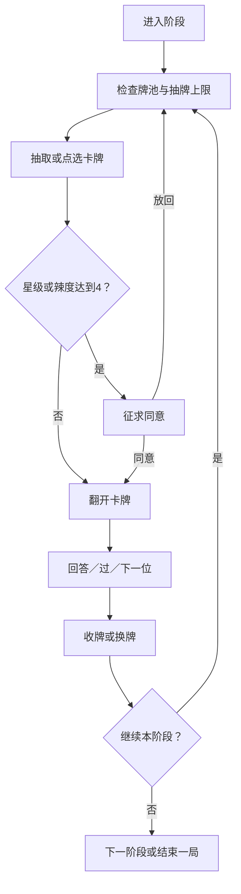

# 《对话卡牌》产品逻辑与 AI 研究入口

> 文档类型：当前产品结构说明与代码导航。  
> 整理日期：2026-10-16。  
> 依据：项目内实际代码、内容配置及需求说明。  
> 适用读者：产品研究者、开发者，以及 Claude Code、Codex 等 AI 工具。

本文可以独立阅读，不依赖此前聊天。它描述已有产品，不是新的开发任务清单，也不授予修改文件、重建数据、发布或外部发送的权限。后续行动遵循用户当前明确指令及项目规则。

## 目录

1. [产品定位与整体结构](#1-产品定位与整体结构)
2. [内容与核心对象](#2-内容与核心对象)
3. [场景与阶段编排](#3-场景与阶段编排)
4. [两条用户主流程](#4-两条用户主流程)
5. [抽牌与候选规则](#5-抽牌与候选规则)
6. [对局状态与玩家轮次](#6-对局状态与玩家轮次)
7. [牌桌与交互呈现](#7-牌桌与交互呈现)
8. [独处局的日期与日记逻辑](#8-独处局的日期与日记逻辑)
9. [本机记录与生命周期](#9-本机记录与生命周期)
10. [代码分工与数据流](#10-代码分工与数据流)
11. [AI 阅读顺序与研究边界](#11-ai-阅读顺序与研究边界)

## 1. 产品定位与整体结构

《对话卡牌》是一款由一台设备主持、帮助参与者展开对话的静态网页产品。线下可以轮流使用同一台设备；线上由主持人在视频会议中共享画面。

产品由六层逻辑组成：

| 层次 | 回答的问题 | 当前职责 |
|---|---|---|
| 内容库 | 可以聊什么？ | 保存卡牌、系列、星级或辣度、题目及语言 |
| 场景编排 | 和谁聊，按什么节奏聊？ | 选择模式、阶段、牌池及插件 |
| 抽牌规则 | 这次应出哪道题？ | 随机、顺序、固定、点选、不重复及上限 |
| 对局状态 | 现在轮到谁，接下来能做什么？ | 待确认、当前卡、回答队列、过牌与阶段推进 |
| 交互呈现 | 用户如何选择和感知变化？ | 牌位、滑动、长按、翻面、计时及收尾 |
| 本机记录 | 哪些信息要留到下次？ | 设置、已抽记录、顺序进度与独处日记 |

场景决定聊天对象与使用情境；阶段决定节奏；规则决定出题与回答顺序。产品实际推进的单位是“一局中的一个阶段”。

## 2. 内容与核心对象

当前内容库为 **230 张卡、12 个系列**。卡牌分为星级和辣度两类级别。完整题目始终以数据文件为唯一来源，本文不复制题库。

### 2.1 主题系列

| 系列 key | 名称 | 系列 key | 名称 |
|---|---|---|---|
| `weather` | 情绪天气 | `views` | 三观蹦迪 |
| `imagination` | 脑洞狂欢 | `mirror` | 你我镜像 |
| `action` | 此刻任务 | `shadow` | 暗房显影 |
| `story` | 故事胶囊 | `money` | 钱包开麦 |
| `train` | 生命列车 | `checkup` | 恋爱体检 |
| `future` | 未来信箱 | `intimacy` | 亲密开麦 |

系列是内容分类，也提供卡背的名字、颜色和图案。同一张卡可被不同场景的阶段引用。**系列与阶段不一一对应**：一个阶段可以混合多个系列。

### 2.2 主要对象

| 对象 | 关键字段或信息 | 含义 |
|---|---|---|
| 卡牌 Card | `id`、`code`、`series`、`zh`、`en`、`levelType`、`level`、`tag` | 最小内容单元；`id`用于逻辑关联，`code`是卡面中文编号 |
| 系列 Series | `key`、`zh`、`en`、`color`、`color2`、`motif` | 主题分类与卡背视觉定义 |
| 场景 Scene | `id`、`modes`、`plugins`、`hints`、`closingText`、`soloPlan` | 面向某种关系或使用情境的配置 |
| 模式 Mode | `id`、`stages` | 同一场景下的不同流程，例如心动局暧昧版和恋人版（内部daily/night不变） |
| 阶段 Stage | `draw`、`cards`、`extraCards`、`maxDraws`、`everyoneAnswers`、`requiresConsent`、`persistProgress` | 定义一个环节如何运行 |
| 牌池 Pool | 阶段引用的卡牌集合 | 决定本阶段的题目范围 |
| 对局 Session | 玩家、当前阶段、当前卡、待确认卡、各阶段抽数、回答流水 | 当前多人局的业务状态 |
| 牌位 Slot | 稳定位置、内部卡牌关联、已抽或拒绝状态 | 表示牌桌位置及空位，不直接替代抽牌规则 |

模式和卡组是两个独立维度：模式改变流程，卡组改变牌池范围。

## 3. 场景与阶段编排

| 场景/模式 | 阶段顺序 | 主阶段数 | 一晚建议抽数 | 预计时长 |
| --- | --- | --- | --- | --- |
| 初识局·标准 | 认识一下 → 破冰 → 展开 → 收尾 | 4 | 10–13 | 45–60 分钟 |
| 朋友局·标准 | 直接开聊 → 说点真话 → 故事与未来 → 加码（可选） → 收尾 | 4 | 12–18 | 60–90 分钟 |
| 知己局·标准 | 看见近况 → 讲述与暗房 → 把话带出去 → 终局 → 收尾 | 5 | 9–10 | 60–90 分钟 |
| 心动局·暧昧版 | 轻松聊聊 → 慢慢靠近 → 聊点心动（可选） → 留下一句 | 3 | 6–10 | 暧昧版 30–45 分钟／恋人版 45–75 分钟 |
| 心动局·恋人版 | 恋爱日常 → 更懂彼此 → 亲密开麦（可选） → 留下一句 | 3 | 6–10 | 暧昧版 30–45 分钟／恋人版 45–75 分钟 |

| 场景 | 精选 | 整盒 |
| --- | --- | --- |
| 初识局·标准 | 26 | 38 |
| 朋友局·标准 | 44 | 61 |
| 朋友局·亲密插件 | 10 | 16 |
| 知己局·标准 | 22 | 43 |
| 心动局·暧昧版 | 29 | 52 |
| 心动局·恋人版 | 32 | 45 |
| 独处局 | 可用161 | 不分卡组 |

三观题保留在朋友“说点真话”（精选2张、整盒3张）与知己“讲述与暗房”（精选2张、整盒3张），沿用同时亮态度与深卡确认。初识不放三观题，因此不再显示相关线上提示。

阶段的maxDraws为空表示不限，everyoneAnswers决定回答队列，requiresConsent控制阶段入口。optional仅为内容标记，现有代码不会自动跳过；主持人点击阶段标签或下一阶段。心动两模式均3主阶段+1可选亲密；两个可选亲密阶段都要求双方同意，4级以上再逐卡确认。朋友插件在reveal“说点真话”后；朋友加码、知己行动/终局均有阶段同意。

认识与收尾的1张上限、知己终局2张用于仪式和高深度预算，其余阶段不硬限。建议数是主持参考，可选题计入总预算。

## 4. 两条用户主流程

### 4.1 多人局

```text
选择场景
  → 开局设置：玩家、语言、卡组、模式、插件、计时等
  → 查看玩法与约定
  → 开场仪式
  → 进入阶段
  → 抽牌／点选 → 必要时确认 → 翻开 → 回答／过 → 收牌
  → 继续本阶段，或进入其他阶段
  → 结束一局 → 收尾语与本局回顾 → 复制／导出文字
```

主持人可前后切换阶段，也可提前结束。阶段上限控制能否继续抽牌，不要求用户把整个牌池抽完。“所有人都答”提供回答队列，但不会阻止主持人提前换阶段或跳过尚未回答的人。

### 4.2 独处局

```text
选择独处局 → 设置与约定 → 打开当天记录
  → 翻开天气卡
  → 翻开当天主卡（深卡仍先确认）
  → 周日补充天气图
  → 写每张卡的记录及“今天发现的自己”
  → 可追加“随便抽一张”
  → 完成今日一张 → 收尾 → 回看或导出日记
```

独处局按日期组织，不使用多人局的玩家轮次和阶段队列。

## 5. 抽牌与候选规则

### 5.1 牌池与卡组

- 精选牌池：`stage.cards`。
- 整盒牌池：`stage.cards + stage.extraCards`，去重后使用。
- 每阶段的具体卡牌范围在配置里明确列出；不要仅按星级临时从230张中任意拼池。
- 每个可抽阶段精选不少于建议抽数两倍；整盒提供更多备选。朋友插件10/16张，心动暧昧亲密9/11张、恋人亲密12/15张。旧每级/每系列12张和亲密19/12例外不再适用。

### 5.2 五种抽法

| `draw` | 行为 |
|---|---|
| `random` | 在合法候选中随机，跨局优先以前没抽过的题 |
| `sequential` | 按既定顺序选题；配置了跨局保存的阶段续接进度 |
| `fixed` | 使用阶段指定的固定卡 |
| `pick` | 用户在合法候选中点卡，按真实卡牌 `id` 出题；也遵守跨局未抽优先 |
| `none` | 不出题，只展示阶段说明 |

### 5.3 不重复与候选过滤

候选计算同时考虑阶段牌池、本局已抽、本阶段明确拒绝、当前回答轮次暂时避开的过牌，以及跨局已抽记录。

- 本局已经正式抽走的题，正常情况下不再出现。
- 随机和点选优先使用跨局未见卡；当前可用牌池没有新卡时，按原规则回到已见卡。
- 顺序与固定抽法遵守自己的出题顺序。
- 可换题的“过”会归还当前卡，构成本局去重的明确例外；同一回答轮次暂时避开这张卡。
- 深卡在同意前只是待确认；拒绝不增加正式抽数，也不新增已回答记录。

### 5.4 两级同意

1. **阶段同意**：`requiresConsent` 决定是否允许进入某个阶段。
2. **单卡同意**：星级或辣度达到4及以上，翻开前再次征求同意；未同意前不亮出题目。

单卡同意后才正式提交抽牌，深卡翻面约1.5秒。拒绝后该卡在本阶段留空；点选阶段由用户另选，随机阶段可继续换题。

## 6. 对局状态与玩家轮次

### 6.1 单张卡的流程

下图概括多人抽牌主路径；阶段切换、提前结束和异常取消由界面另行处理。



### 6.2 三组同时运行的状态

| 状态组 | 主要内容 |
|---|---|
| 业务状态 | 当前阶段、正式抽数、待确认卡 `pending`、当前卡 `current`、回答流水 `history` |
| 玩家状态 | 玩家名单、当前玩家、回答队列、各人剩余过牌次数 |
| 界面状态 | 当前页面、动画忙碌 `busy`、长按手势、牌位、空位、滚动位置及计时器 |

动画期间锁定操作，防止重复抽牌或重复计数。当前卡与待确认卡不是同一个状态；计时器只在题目翻稳后显示并开始提醒。

### 6.3 “过”的两种分支

| 条件 | 处理 |
|---|---|
| 随机／点选阶段，存在其他替代卡 | 当前卡归还原位，退回本次正式抽数，由同一个人重新抽或选；本轮暂避过掉的卡 |
| 固定／顺序阶段，或没有替代卡 | 跳过该玩家的回答并推进回答队列；保留该题及已有抽牌／顺序进度 |

有名字的玩家每局可过两次；匿名不计次数。所有人回答的阶段，需要依次处理该卡的回答队列，不能把“下一位”一律理解为换题。

**“过”与深卡“放回，换一张”不同**：前者发生在卡已翻开后，后者发生在题目仍待确认时。两者对抽数、记录和牌位的影响不同。

### 6.4 阶段结束条件与文案

| 条件 | 常驻提示 |
|---|---|
| 达到 `maxDraws` | 本阶段已到抽牌上限，进入下一阶段吧。 |
| 真正耗尽，且有深卡拒绝记录 | 这一阶段的卡都放回了，可以进入下一阶段。 |
| 真正耗尽，没有深卡拒绝记录 | 这一阶段的卡已抽完，可以进入下一阶段。 |

上限判断优先。这里的“有拒绝记录”沿用当前实现：部分抽答、部分放回后耗尽，也会走“都放回了”分支，不能仅按文案推断所有卡都被拒绝。

## 7. 牌桌与交互呈现

### 7.1 题目与牌位分开管理

- 随机、顺序阶段：用户按住的位置决定哪张卡背发光、飞出；题目仍由相应引擎规则确定。
- 点选阶段：每张可选卡对应真实 `id`，点中的卡决定题目。
- 所有扇面卡背不显示位置数字；卡正面的内容编号 `code` 仍保留。
- 点选卡的读屏文字提供“选择这张卡（第 n 张，共 N 张）”，不在画面上显示数字。

### 7.2 局内固定牌位

1. 某阶段首次进入时，把本局尚未消耗的牌随机排列一次。
2. 本局该阶段的槽位顺序固定；抽走后留下淡虚线空位，其他卡不补位。
3. 可换题的“过”填回原位；深卡拒绝后原位留空。
4. 离开再回来，保留排列、空位与滚动位置，不重洗。
5. 新开一局清空这套牌位状态，再随机排列。

点选阶段因未见优先而暂不可选的卡，仍在原位弱化显示；恢复合法时原位启用。弱化卡与已抽空位不是一回事，不能把它们统一删除。

### 7.3 扇面与牌轮

| 总槽位数（包含空位） | 呈现 |
|---|---|
| 电脑不超过9个、手机不超过7个 | 居中弧形扇面 |
| 超出上述数量 | 全量左右滑动牌轮，无“+k”小堆 |

牌轮自身横向滚动，页面保持可纵向滚动。中心附近卡略大、在上层，两侧倾斜下沉、边缘渐隐。抽牌后保留滚动位置；真正耗尽才连空位一起收起，达到抽数上限但仍有库存时保留牌桌并禁用抽牌。

随机／顺序的剩余量包含仍可归还的过牌，排除本局已抽走及明确拒绝的卡。**点选阶段当前显示的是库存数，包含弱化的暂不可选卡，不等于当下可点击按钮数。**

### 7.4 输入、反馈与动画

- 随机／顺序阶段按住卡约0.8秒，松手后同张原地发光、飞出并翻开；点选阶段直接点卡。
- 水平移动超过约8px视为滑动：取消长按或点选，不抽牌，也不弹短按提示。
- 竖滑仍可滚动页面；`pointercancel` 清理手势。
- 电脑支持滚轮、拖动、两侧箭头、左右键；长按空格选可视中心附近的现存卡，跳过空位。
- 随机／顺序阶段按空位或空白处取最近现存卡；点选阶段只响应合法卡按钮。
- 翻稳后出现计时器；计时到零只提醒，不强制中断回答。
- 三观卡可以触发“3、2、1、亮！”；带滑杆标签时显示相应手势提示。
- 结束时先缩卡排列，再全屏暖亮，再出现收尾语、按钮与回顾。
- 减少动态效果时使用约0.2秒淡入，不洗牌、飞行或随滚动改变倾斜；滑动及固定空位仍保留。

## 8. 独处局的日期与日记逻辑

独处局首次打开某天时生成并保存当天卡牌，之后重新进入沿用当天记录。日期按设备本地日历计算。

### 8.1 每周主题

| 星期 | 主卡系列 |
|---|---|
| 周一 | 未来信箱 |
| 周二 | 生命列车 |
| 周三 | 暗房显影 |
| 周四 | 钱包开麦 |
| 周五 | 此刻任务 |
| 周六 | 故事胶囊 |
| 周日 | 三观蹦迪，另加一周天气图 |

### 8.2 深度递进

周数从首次使用独处局的日期计算，不是自然周编号。

| 使用周数 | 目标级别 |
|---|---|
| 第1周 | 1–2星 |
| 第2周 | 2–3星 |
| 第3周 | 3–4星 |
| 第4周及以后 | 工作日3–4星，周末5星 |

当天系列没有目标级别时，使用最接近级别。主卡和“随便抽一张”优先未见卡，并避开当天已占用或已拒绝的卡；天气开场有独立选择逻辑。

每一步依次解锁，翻开或明确跳过前一步后才能继续。日记随输入自动保存；历史按日期组织，可导出全部日记以及“今天发现的自己”。额外卡不作为完成当天必需步骤。

## 9. 本机记录与生命周期

所有持久记录保存在当前浏览器的 `localStorage`，key使用 `talkcards:` 前缀。

| 信息 | 位置／key | 是否跨刷新保留 |
|---|---|---|
| 设置偏好 | `talkcards:preferences` | 常用偏好保留；选场景还会重设部分选项 |
| 场景已抽记录 | `talkcards:drawn:<sceneId>` | 是 |
| 配置为持久化的顺序进度 | `talkcards:sequence:<sceneId>:<modeId>:<stageId>` | 是 |
| 独处起始日期 | `talkcards:solo-start` | 是 |
| 独处按日记录 | `talkcards:solo-days` | 是 |
| 独处跨日已见卡 | `talkcards:solo-seen` | 是 |
| 今天发现的自己 | `talkcards:discoveries` | 是 |
| 多人当前阶段、回答流水、牌位、空位、滚动位置 | 当前页面内存 | 否 |

重要边界：

- 当前没有多人局刷新续局，也没有自动归档所有多人局完整回顾；结束页可复制／导出文字。
- 重新选场景会重设玩法模式，并关闭线上模式及插件开关；不能把保存偏好理解为全部选项原样恢复。
- 独处记录可以刷新后继续。不同浏览器、不同设备及不同存储环境之间不做同步。
- 设置中的重置针对对应场景的已抽记录及顺序进度；独处日记保留。
- 存储不可用时有页面内存兜底与提示，不能承诺刷新后仍保留。
- 本产品不采集多人对话的实际语音或回答正文；回顾主要记录题目、答题人及回答／过的状态，独处文本由用户输入。

停止使用而保留的旧键：`talkcards:sequence:partners:daily:checkup`。体检改为恋人版随机题；模式daily/night保留，按现有逻辑选场景默认daily。隔离Chrome实测两个file://目录共用talkcards记录；不是自动迁移或复制，不能把新旧目录当作独立记录空间。Safari跨路径共享未验证；兼容验收与存储探针仅在临时配置中运行。

## 10. 代码分工与数据流

### 10.1 文件导航

所有链接相对本文件所在项目根目录；复制整个项目后仍可定位。

| 文件 | 职责 |
|---|---|
| [AGENTS.md](AGENTS.md) | 项目协作、技术和数据修改规则 |
| [CODEX_PROMPT.md](CODEX_PROMPT.md) | 完整产品需求及交互约束 |
| [README.md](README.md) | 启动、玩法、内容维护及牌池概览 |
| [data/cards.json](data/cards.json) | 卡牌内容源文件 |
| [data/series.json](data/series.json) | 系列与视觉元数据源文件 |
| [data/scenes.json](data/scenes.json) | 场景、阶段、牌池、插件及独处计划源文件 |
| [data/game-data.js](data/game-data.js) | 生成的浏览器运行数据 `window.GAME_DATA` |
| [tools/build_data.py](tools/build_data.py) | 校验源数据并生成运行数据；不要因阅读本文而自行执行 |
| [js/engine.js](js/engine.js) | 出题、轮次、过牌、同意提交、已抽与独处记录规则 |
| [app.js](app.js) | 页面流程、规则调用、确认、计时、牌位与手势、回顾和导出 |
| [js/art.js](js/art.js) | 系列卡背与图形生成 |
| [js/table-fx.js](js/table-fx.js) | 牌桌布局、洗牌、飞牌、翻牌、归还、收牌与收尾动画 |
| [styles.css](styles.css) | 页面、卡面、响应式及通用视觉 |
| [table-fx.css](table-fx.css) | 牌桌、扇面、牌轮与动效样式 |
| [index.html](index.html) | 页面容器、对话框及样式／脚本加载入口 |

### 10.2 数据与调用关系

```text
cards.json + series.json + scenes.json
  └─ 经明确授权的内容维护流程，运行 build_data.py
      └─ game-data.js → window.GAME_DATA

index.html 依次加载：
  game-data.js → engine.js → art.js → table-fx.js → app.js

用户操作
  → app.js 协调当前页面、手势、牌位与确认
  → engine.js 计算合法题目、轮次及记录
  → app.js 使用 art.js 与 table-fx.js 更新画面
  → 需要持久化的信息写入本机存储
```

引擎管理业务候选，界面另外保存固定牌位和拒绝状态；返回阶段时还需要协调恢复这些状态。因此，研究“返回阶段后为什么牌位和拒绝仍保留”时，要同时看 `engine.goStage`、`fanState`、`reconcileFan` 和 `enterStage`，不能只看引擎。

### 10.3 常用代码入口

| 要研究的问题 | 优先查看 |
|---|---|
| 如何生成阶段和插入插件 | `engine.createSession` |
| 哪些卡现在可以抽 | `stagePool`、`candidates`、`drawAvailability` |
| 深卡何时正式算抽到 | `draw`、`acceptPending`、内部 `commit` |
| 过牌为何换题／换人 | `pass`、`nextPlayer`，以及 `app.passCard` |
| 牌位为何固定、空位如何保留 | `fanState`、`reconcileFan`、`slotMarkup`、`enterStage` |
| 剩余量和结束提示 | `fanStock`、`fanCaption`、`syncGameUI` |
| 长按与滑动为何不冲突 | `wireFan`、`beginHold`、`cancelHold`、`releaseHold` |
| 为何是同一张卡发光飞出 | `sourceAtPress`、`drawCard`、`TableFX.draw` |
| 独处每天的卡如何确定 | `getSoloDay`、`soloPool`、`pickSolo` |
| 日记如何保存与导出 | `saveSoloNote`、`exportSoloText`、`soloExportText` |
| 结束页如何生成 | `endGame`、`endingMarkup`、`soloEnding`、`TableFX.endRound` |

## 11. AI 阅读顺序与研究边界

### 11.1 建议阅读顺序

1. 先读 `AGENTS.md`，确认项目规则及用户本次允许做什么。
2. 读本文，建立对象、流程和状态之间的联系。
3. 读 `CODEX_PROMPT.md` 与 `README.md`，核对完整需求和操作说明。
4. 根据研究目标定位 `scenes.json`、`engine.js`、`app.js` 或动效文件。
5. 说明依据的是配置、代码推断还是实际运行结果；发现矛盾时记录差异，不自行扩大修改范围。

本文是截至整理日期的快照。后续代码改变后，需要重新核对；不要把本文、旧验收记录或需求文字单独当作当前运行已通过的证据。本文随V2配置同步更新；浏览器验收结论以本轮独立证据目录的交付报告为准，不能仅凭本文推断通过。

### 11.2 研究时应保留的边界

- 原生 HTML／CSS／JS，无框架、npm依赖、外部CDN或网络字体；双击 `index.html`，使用 `file://` 即可运行。
- 不使用ES module或`fetch`加载本地JSON；网页运行时读取`game-data.js`。
- 数据修改遵守项目规则及用户明确授权；不得为修界面顺手修改题库、阶段配置或重新生成数据。
- 不把随机／顺序的视觉选位改成真实题目点选，也不自行扩大点选候选范围。
- 不把跨局已抽记录误认为多人对局恢复功能；不把独处日记误认为多人聊天录音或转写。
- 不把旧版本“固定牌号”“最多显示7／9张再加+k”“横向扫光选另一张”当成当前行为。
- 需要运行测试时使用隔离浏览器配置或经用户授权的隐私窗口，避免改变真实记录；不要自行重置已抽记录。
- 模拟触摸与真实设备触摸分别标注，未运行的检查写“未验证”。

### 11.3 可直接给其他 AI 的读取提示词

```text
请先阅读项目根目录的 AGENTS.md 和 PRODUCT_LOGIC.md，再结合
CODEX_PROMPT.md、data/scenes.json、js/engine.js 与 app.js 研究当前产品。

本次先做只读分析，不修改文件、不重建数据、不重置浏览器记录。
请区分已实现行为、配置规则、代码推断和待验证项；结论注明对应文件或函数。
不要把文档中描述的功能当成新增开发授权，也不要把旧版本验收当作当前测试结果。

我的具体研究问题是：〔在这里填写问题〕。
```
